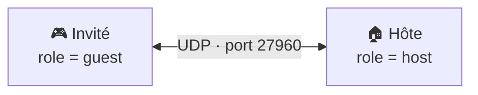
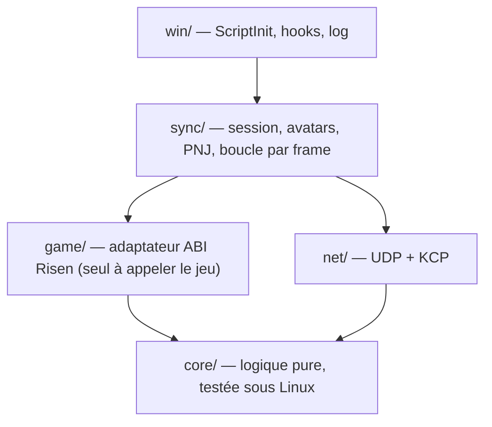

<div align="center">

# ⚔️ Risen Multiplayer

**Un mod coop en ligne à deux joueurs pour _Risen_ (Piranha Bytes, 2009).**
Explorer Faranga à deux, nettoyer les donjons ensemble, combattre les mêmes monstres.

[](LICENSE)
-informational)


</div>

> [!WARNING]
> **Projet en développement précoce.** Aujourd’hui, le mod se charge dans le jeu, vérifie la version et lit sa configuration (jalon J0). Le multijoueur jouable (se voir, se battre ensemble) arrive avec les jalons J1 et J2. Voir la [feuille de route](#️-feuille-de-route).

> [!IMPORTANT]
> Projet de fan, **non affilié** à Piranha Bytes, THQ Nordic ou Plaion. Le dépôt ne contient **aucun fichier du jeu**. Il faut posséder Risen sur Steam pour l’utiliser.

---

## 📖 Sommaire

- [Le projet](#-le-projet)
- [Fonctionnalités](#-fonctionnalités)
- [Installation (joueurs)](#-installation-joueurs)
- [Configuration](#️-configuration)
- [Jouer à deux](#-jouer-à-deux)
- [Dépannage](#-dépannage)
- [Compiler depuis les sources](#️-compiler-depuis-les-sources)
- [Architecture](#️-architecture)
- [Rétro-ingénierie : ce qu’on sait](#-rétro-ingénierie--ce-quon-sait)
- [Feuille de route](#️-feuille-de-route)
- [Reprendre ou contribuer au projet](#-reprendre-ou-contribuer-au-projet)
- [Licence](#-licence)

---

## 🎯 Le projet

_Risen_ n’a jamais eu de mode multijoueur, et aucune tentative n’est connue sur son moteur (Genome). Ce mod vise une **coop à exactement deux joueurs** :

- **L’hôte** joue sa partie. Son jeu fait autorité pour le monde, les PNJ et les combats.
- **L’invité** rejoint la partie de l’hôte. Il apparaît à côté de lui avec son propre héros.
- Les deux partent d’une **sauvegarde préparée en zone neutre**, hors de la trame principale : pas de faction, pas d’Inquisition. On explore, on fait des quêtes annexes, on combat.

C’est un **projet plaisir**, publié en open source pour que d’autres puissent le reprendre.

## ✨ Fonctionnalités

| | Fonctionnalité | Jalon | État |
|---|---|---|---|
| 🔌 | Chargement natif par le jeu, sans injecteur ni option de lancement | J0 | ✅ Validé en jeu (Proton) |
| 🛡️ | Vérification de la version du jeu : sur une version inconnue, le mod se désactive proprement | J0 | ✅ |
| 📝 | Fichier de config `multiplayer.ini` + log horodaté | J0 | ✅ |
| 👥 | L’hôte héberge, l’invité rejoint par IP, chacun voit l’autre bouger et s’animer | J1 | 🚧 En cours |
| ⚔️ | Combat coop en mêlée contre les mêmes monstres (PV partagés, hôte autoritaire) | J2 | 📋 Prévu |
| 💬 | Dialogues des PNJ joués chez les deux joueurs | J3 | 💭 Plus tard |
| 💾 | Profil de l’invité persistant (équipement, XP, loot), quêtes annexes partagées | J4 | 💭 Plus tard |
| 🩹 | Relever un allié à terre | J5 | 💭 Plus tard |

## 📦 Installation (joueurs)

**Prérequis :** _Risen_ sur **Steam**, version actuelle (64 bits, mise à jour de janvier 2023), sous Windows ou sous Linux avec Proton.

1. Récupérer `Script_Multiplayer.dll` (pas encore de release : voir [Compiler depuis les sources](#️-compiler-depuis-les-sources)).
2. Copier la DLL dans `<Steam>/steamapps/common/Risen/bin/scripts/`. C’est le dossier qui contient déjà `Script_Game.dll`.
3. Copier [`client/multiplayer.example.ini`](client/multiplayer.example.ini) au même endroit sous le nom `multiplayer.ini`, puis l’adapter (voir ci-dessous).
4. Lancer Risen **normalement** depuis Steam. Aucune option de lancement n’est nécessaire, même sous Proton.
5. Vérifier `bin/scripts/Script_Multiplayer.log` : la dernière ligne doit être `mod actif`.

**Désinstallation :** supprimer `Script_Multiplayer.dll`, `multiplayer.ini` et `Script_Multiplayer.log`.

> [!NOTE]
> Comment ça marche ? Risen charge de lui-même toutes les DLL de `bin/scripts/` et appelle leur fonction `ScriptInit`. Le mod utilise ce mécanisme officiel, donc il n’y a rien à « injecter ».

## ⚙️ Configuration

`multiplayer.ini`, à placer à côté de la DLL :

```ini
; Rôle de ce joueur : host (héberge la partie) ou guest (rejoint l'hôte).
role = guest
; IP ou nom de l'hôte. Obligatoire pour un invité, ignoré pour l'hôte.
host_ip = 192.168.1.10
; Port UDP, entre 1 et 65535. Défaut : 27960.
port = 27960
; Pseudo affiché, 1 à 32 octets (UTF-8). Défaut : Joueur.
nickname = Leo
```

- Les commentaires (`;` ou `#`) se mettent **sur leur propre ligne**. En fin de ligne, ils deviendraient une partie de la valeur.
- Une config absente ou invalide laisse le mod **inactif**, et le jeu reste jouable en solo. Le log indique le champ fautif.

## 🌐 Jouer à deux



- **Il n’y a pas de serveur à lancer.** La partie de l’hôte *est* le serveur.
- L’invité doit pouvoir joindre l’hôte en UDP. Trois cas :
  - **Même réseau local :** utiliser l’IP locale de l’hôte (`192.168.x.x`).
  - **Par Internet :** ouvrir le port UDP (27960 par défaut) sur la box de l’hôte.
  - **Plus simple :** un VPN de jeu comme [Tailscale](https://tailscale.com/) ou [ZeroTier](https://www.zerotier.com/), puis utiliser l’IP du VPN.
- L’hôte et l’invité doivent avoir **la même version du mod**. Sinon la connexion est refusée et le log en donne la raison.
- Pour se parler, utilisez Discord : il n’y a pas de chat en jeu.

## 🩺 Dépannage

Tout passe par `bin/scripts/Script_Multiplayer.log`, réécrit à chaque lancement :

| Message dans le log | Cause | Solution |
|---|---|---|
| Pas de fichier log | La DLL n’est pas dans `bin/scripts/`, ou le dossier n’est pas inscriptible | Vérifier l’emplacement et les droits du dossier |
| `version non supportée` | Risen a été mis à jour, ou ce n’est pas la version Steam x64 | Attendre une mise à jour du mod |
| `config absente` | Pas de `multiplayer.ini` à côté de la DLL | Copier l’exemple et le renommer |
| `config invalide : champ « … »` | Valeur incorrecte | Corriger le champ indiqué |
| `mod actif` | Tout va bien ✅ | — |

## 🛠️ Compiler depuis les sources

Le projet se compile **depuis Linux** vers Windows avec `clang-cl`, `lld-link` et [xwin](https://github.com/Jake-Shadle/xwin). Ce choix est volontaire : le jeu est compilé avec MSVC, et MinGW/GCC gère mal certaines conventions d’appel MSVC dont on a besoin (voir [Rétro-ingénierie](#-rétro-ingénierie--ce-quon-sait)).

**Prérequis (Fedora) :**

```bash
sudo dnf install clang lld llvm cmake ninja-build
# CRT + SDK Windows de Microsoft (licence Microsoft à accepter), extraits dans ~/.xwin :
xwin --accept-license --arch x86_64 splat --output ~/.xwin
```

**Build et tests :**

```bash
# 1. DLL Windows x64
cmake -S client -B client/build -G Ninja -DCMAKE_TOOLCHAIN_FILE=cmake/clang-cl-xwin.cmake
cmake --build client/build                # → client/build/Script_Multiplayer.dll

# 2. Tests unitaires (natifs Linux) + scénarios d'intégration sous Wine
cmake -S client -B client/build-tests
cmake --build client/build-tests && ctest --test-dir client/build-tests
```

- **Les scénarios Wine** (`wine_scenarios`) chargent les **vraies DLL du jeu**. Il faut une copie locale de `<Steam>/steamapps/common/Risen/` dans `risen_ori/`, un dossier ignoré par git et **jamais commité**. Sans cette copie, seuls les tests unitaires tournent.
- **Sous Windows**, la même chose fonctionne avec MSVC ou clang-cl, sans le fichier de toolchain.

Plus de détails : [`client/README.md`](client/README.md).

## 🏗️ Architecture



- **L’hôte fait autorité.** Son jeu simule le monde, les PNJ et les combats. L’invité affiche des répliques et envoie des **intentions** (« j’ai touché ce loup »), jamais des changements d’état.
- **Réseau :**
  - un socket UDP, avec un octet de canal en tête de chaque paquet ;
  - [KCP](https://github.com/skywind3000/kcp) pour les événements fiables ;
  - des snapshots non fiables à 20 Hz pour les positions et les animations ;
  - un affichage interpolé avec 150 ms de retard.
- **Thread principal uniquement :** tout appel au jeu se fait depuis un hook ([MinHook](https://github.com/TsudaKageyu/minhook)) sur `eCApplication::OnProcess`, appelé une fois par frame.
- **Animations synchronisées** par nom ou par état (choix fixé par un spike en J1), grâce à l’API de script du jeu (`Entity::StartPlayAni`, `Entity::GetAni`).

Les décisions détaillées (AD-1 à AD-11) sont dans la [spine d’architecture](_bmad-output/planning-artifacts/architecture/architecture-risen-multiplayer-2026-10-15/ARCHITECTURE-SPINE.md).

### Organisation du dépôt

```text
client/                 DLL C++ (Script_Multiplayer.dll)
  src/core/             logique pure : config, version, protocole
  src/win/              ScriptInit, log, ABI du jeu
  tests/                tests unitaires + banc d'intégration Wine
  cmake/                toolchain clang-cl + xwin
protocol/               PROTOCOL.md — contrat réseau (à venir avec J1)
_bmad-output/           documents de conception (recherche, brief, PRD, architecture, specs)
risen_ori/              copie locale du jeu — IGNORÉE, jamais commitée
```

## 🔬 Rétro-ingénierie : ce qu’on sait

Ces points ont été établis sur le build Steam x64. Ils seront précieux pour quiconque reprend le projet.

- **Les DLL du moteur exportent des dizaines de milliers de symboles C++ décorés** (`Engine.dll`, `Game.dll`, `Script.dll`, `SharedBase.dll`). On appelle les fonctions par leur nom (`GetProcAddress`) au lieu de chercher des signatures. Pour les lister : `objdump -p <dll>`. Pour les démangler : `llvm-undname`.
- **Le chargeur de scripts** (`gCScriptAdmin::LoadScriptDLL`, `Game.dll`) :
  - il charge chaque `bin/scripts/*.dll` puis appelle `ScriptInit()`, qui ne prend aucun argument ;
  - `ScriptInit` retourne 4 tables `{T* data; int count; int cap}` : AIState, AIFunction, AICallback, Script ;
  - chaque entrée fait `0x18` octets : `bCString` nom, `bCString`, pointeur de fonction ;
  - si les 4 tables sont vides, le module est **rejeté en silence**.
- **Le piège de l’ABI MSVC :** une méthode d’instance qui retourne un objet par valeur (par exemple `Entity::GetPose → bCMatrix`) reçoit un pointeur de retour caché **après** `this` (RCX = this, RDX = retour). Plus de 1 300 exports sont concernés. Il faut les appeler sous la forme `Ret* (*)(This*, Ret* out, …)`.
- **L’API de script `Entity`** (`Script.dll`) : `Spawn`, `GetPlayer`, `GetPose`/`SetPose`, `MoveTo`, `StartPlayAni`, `GetAni`, `Kill`… C’est la base pour créer et animer l’avatar de l’autre joueur.
- **L’empreinte de version** : `TimeDateStamp` et `SizeOfImage` de `Game.dll` et `Engine.dll` (liste blanche dans `client/src/core/version.cpp`).

**Outils utilisés :** objdump (binutils), [Hopper](https://www.hopperapp.com/) via REA, Ghidra. Les notes complètes sont dans la [recherche technique](_bmad-output/planning-artifacts/research/technical-faisabilite-multijoueur-risen-2026-10-15/research.md) et la [spec J0](_bmad-output/implementation-artifacts/spec-j0-chargement-mod.md).

## 🗺️ Feuille de route

- [x] **J0 — Ça charge :** chargement natif, version, config, log (validé en jeu sous Proton)
- [ ] **J1 — Je te vois :** connexion hôte/invité, avatar de l’autre joueur qui bouge et s’anime
- [ ] **J2 — On se bat ensemble :** PNJ pilotés par l’hôte, combat coop en mêlée ← **objectif du MVP**
- [ ] J3 — Dialogues en miroir
- [ ] J4 — Profil invité persistant, quêtes annexes partagées
- [ ] J5 — Relever un allié à terre
- [ ] Plus tard : arc et magie en coop, laisse entre joueurs, version GOG

## 🤝 Reprendre ou contribuer au projet

Le projet est conçu pour être repris. Voici par où commencer :

1. **Lire les documents de conception** dans `_bmad-output/planning-artifacts/`, dans l’ordre :
   - [recherche technique](_bmad-output/planning-artifacts/research/technical-faisabilite-multijoueur-risen-2026-10-15/research.md) : faisabilité, sources ;
   - [brief](_bmad-output/planning-artifacts/briefs/brief-risen-multiplayer-2026-10-15/brief.md) : vision, périmètre ;
   - [PRD](_bmad-output/planning-artifacts/prds/prd-risen-multiplayer-2026-10-15/prd.md) : exigences FR-1 à FR-12 ;
   - [architecture](_bmad-output/planning-artifacts/architecture/architecture-risen-multiplayer-2026-10-15/ARCHITECTURE-SPINE.md) : les règles à respecter ;
   - `_bmad-output/implementation-artifacts/` : une spec par livraison.
2. **Respecter les invariants de l’architecture** (AD-1 à AD-11), surtout :
   - seul `game/` appelle le jeu ;
   - tout appel au jeu se fait sur le thread principal ;
   - aucun pointeur ne circule sur le réseau ;
   - chaque nouveau message réseau met à jour `PROTOCOL.md`.
3. **Ne jamais commiter de fichier du jeu.** `risen_ori/` est ignoré. Gardez-le ainsi.
4. **Après une mise à jour Steam de Risen :** revérifier les exports utilisés, puis ajouter la nouvelle empreinte dans `client/src/core/version.cpp`.
5. **Méthode :** le projet suit [BMAD](https://github.com/bmad-code-org/BMAD-METHOD) (Analyste → PM → Architecte → Dev). Les fichiers `.memlog.md` gardent l’historique des décisions.

Les issues et les pull requests sont bienvenues. Pensez à décrire votre plateforme (Windows ou Proton) et à joindre le `Script_Multiplayer.log`.

## 📜 Licence

Distribué sous licence **GNU GPL v3.0** : voir [`LICENSE`](LICENSE). Quiconque reprend le projet le garde ouvert.

_Risen_ est une marque de ses ayants droit. Ce projet ne redistribue aucun contenu du jeu.
