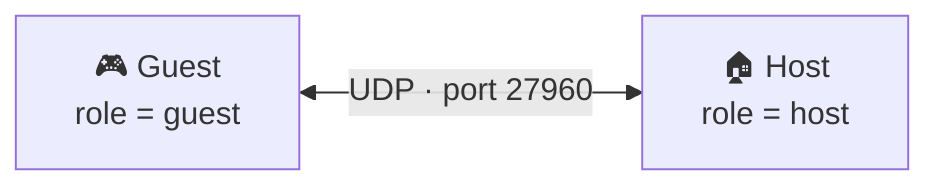
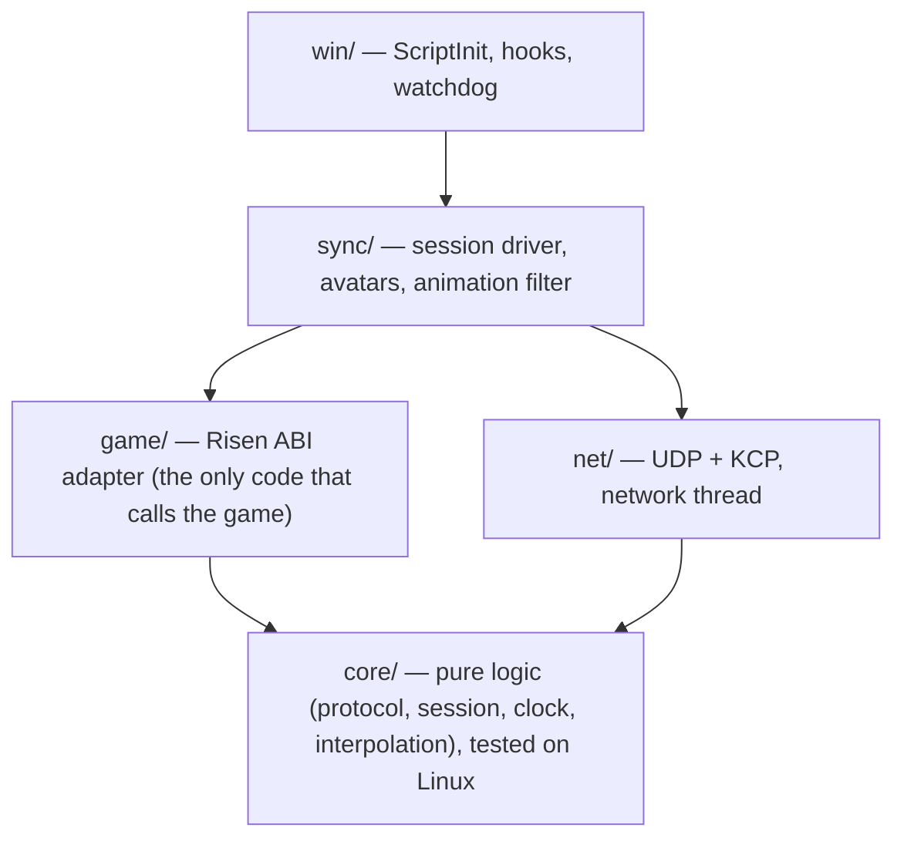

<div align="center">

# ⚔️ Risen Multiplayer

**A two-player online co-op mod for _Risen_ (Piranha Bytes, 2009).**
Explore Faranga together, clear dungeons side by side, fight the same monsters.

[](LICENSE)
-informational)


</div>

> [!WARNING]
> **Early development.** The mod loads natively, hosts or joins a session, and shows the other player's avatar moving, animating, holding the same weapon, wearing the same armour and the guest's starting equipment (milestone J1, start of J2). This has been validated in-game on one machine against a scripted fake guest. The two-machine validation and co-op combat (rest of J2) are next. See the [roadmap](#️-roadmap).

> [!IMPORTANT]
> Fan project, **not affiliated** with Piranha Bytes, THQ Nordic or Plaion. The repository contains **no game files**. You need to own Risen on Steam to use it.

---

## 📖 Contents

- [The project](#-the-project)
- [Features](#-features)
- [Installation (players)](#-installation-players)
- [Configuration](#️-configuration)
- [Playing together](#-playing-together)
- [Troubleshooting](#-troubleshooting)
- [Building from source](#️-building-from-source)
- [Testing without a second player](#-testing-without-a-second-player)
- [Architecture](#️-architecture)
- [Reverse engineering: what we know](#-reverse-engineering-what-we-know)
- [Roadmap](#️-roadmap)
- [Taking over or contributing](#-taking-over-or-contributing)
- [License](#-license)

---

## 🎯 The project

_Risen_ never had a multiplayer mode, and there is no known attempt on its engine (Genome). This mod aims at **co-op for exactly two players**:

- **The host** plays their own game. Their game is authoritative for the world, NPCs and combat.
- **The guest** joins the host's game and appears next to them with their own hero.
- Both start from a **save prepared in a neutral area**, outside the main storyline: no faction, no Inquisition. You explore, do side quests and fight.

This is a **hobby project**, released as open source so that others can pick it up.

## ✨ Features

| | Feature | Milestone | Status |
|---|---|---|---|
| 🔌 | Native loading by the game, no injector or launch option | J0 | ✅ Validated in-game (Proton) |
| 🛡️ | Game version check: on an unknown version, the mod disables itself cleanly | J0 | ✅ |
| 📝 | `multiplayer.ini` config file + timestamped log | J0 | ✅ |
| 🔗 | Host listens, guest joins by IP; version/fingerprint checks; clean session end (quit, reload, death) | J1 | ✅ Validated in-game |
| 👥 | Each player sees the other's avatar: appears next to the host, moves smoothly (20 Hz, interpolated), replays gestures (walk, run, jump, draw, attacks, death) | J1 | ✅ Validated on one machine — two-machine test pending |
| 🗡️ | The avatar holds the same weapon as its player, drawn or sheathed (any one-handed weapon, axe, fists) | J2 | ✅ Validated on one machine |
| 🎽 | Guest equipment from `guest_equipment`: the guest's hero is equipped on joining (items created only if missing), and its avatar on the host wears it | J2 | ✅ Validated on one machine (avatar side) |
| 🛡️ | The avatar wears the same armour as its player, both ways, changed or removed during the session | J2 | ✅ Validated on one machine |
| 👹 | NPC replicas: on the guest, the NPCs within 50 m of either player follow the host's positions and HP, with their local AI frozen (released at session end) | J2 | 🧪 Implemented (story 3.3), in-game test pending |
| ⚔️ | Melee co-op combat against the same monsters (shared HP, host-authoritative) | J2 | 🚧 In progress (stories 3.4 to 3.7) |
| 💬 | NPC dialogues played on both sides | J3 | 💭 Later |
| 💾 | Persistent guest profile (gear, XP, loot), shared side quests | J4 | 💭 Later |
| 🩹 | Reviving a downed ally | J5 | 💭 Later |

**Known J1 limitations** (tracked in [`deferred-work.md`](_bmad-output/implementation-artifacts/deferred-work.md)):
- the avatar has no collisions in your world: you walk through it. This is a choice (story 3.1): the "solid" setup found in the J2 spike detaches its animated model. NPCs still target and hit it;
- the walk → stop transition is not very smooth, and the walk animation can occasionally stall for a moment;
- only the right hand and the armour are replicated (no shield, torch, rings or amulets);
- a guest who sells or drops an item listed in `guest_equipment` gets it back on the next session (items are created when missing);
- NPC replicas (story 3.3) are still animated by the guest's engine, and their deaths are not replicated yet (story 3.4); an NPC that only exists in the host's game (spawned during play) is ignored on the guest;
- in story 3.3 the guest's hero can still hit or even kill a replica locally: damage is not synchronised yet (stories 3.5 and 3.6), so the replica's HP is simply overwritten by the host's on the next change.

## 📦 Installation (players)

**Requirements:** _Risen_ on **Steam**, current version (64-bit, January 2023 update), on Windows or on Linux with Proton.

1. Get `Script_Multiplayer.dll` (no release yet: see [Building from source](#️-building-from-source)).
2. Copy the DLL into `<Steam>/steamapps/common/Risen/bin/scripts/`. This is the folder that already contains `Script_Game.dll`.
3. Copy [`client/multiplayer.example.ini`](client/multiplayer.example.ini) to the same folder as `multiplayer.ini`, then edit it (see below).
4. **On Linux/Proton, disable the Steam overlay for Risen** (Properties → General → "Enable the Steam Overlay while in-game"). Otherwise the game can freeze during a session (see [Troubleshooting](#-troubleshooting)).
5. Launch Risen **normally** from Steam. No launch option is needed, even with Proton.
6. Check `bin/scripts/Script_Multiplayer.log`: you should see `mod actif`, then `hooks de session installés`.

**Uninstall:** delete `Script_Multiplayer.dll`, `multiplayer.ini` and `Script_Multiplayer.log`.

> [!NOTE]
> How does it work? Risen loads every DLL in `bin/scripts/` by itself and calls its `ScriptInit` function. The mod uses this official mechanism, so there is nothing to "inject".

## ⚙️ Configuration

`multiplayer.ini`, next to the DLL:

```ini
; This player's role: host (hosts the game) or guest (joins the host).
role = guest
; Host IPv4 address. Required for a guest, ignored for the host (no hostname, no IPv6).
host_ip = 192.168.1.10
; UDP port, 1 to 65535. Default: 27960.
port = 27960
; Display name, 1 to 32 bytes (UTF-8). Default: Joueur.
nickname = Leo
; Guest starting equipment: game template names separated by commas (1 to 64 characters
; A-Z a-z 0-9 _ each, 16 names, 255 bytes at most). Validated in both roles, applied as guest only:
; the hero equips them on joining (created if missing), and the host dresses the guest's avatar.
guest_equipment = It_Armor_Don_Fighter, It_1H_Sword_Rusty
; debug writes diagnostics (snapshots, animations, locomotion) every few seconds. Default: info.
log_level = info
; Reverse-engineering probe (J1 spike). Keep 0 to play.
probe = 0
```

- Comments (`;` or `#`) go **on their own line**. At the end of a line, they would become part of the value.
- A missing or invalid config leaves the mod **inactive**, and the game stays playable solo. The log names the faulty field.

## 🌐 Playing together



- **There is no server to run.** The host's game *is* the server. Strictly two players: a third client is refused ("session pleine").
- The session starts by itself once a save is loaded. The guest's hero is teleported 2 m in front of the host.
- The guest must be able to reach the host over UDP. Three options:
  - **Same local network:** use the host's local IP (`192.168.x.x`).
  - **Over the Internet:** forward the UDP port (27960 by default) on the host's router.
  - **Easiest:** a gaming VPN such as [Tailscale](https://tailscale.com/) or [ZeroTier](https://www.zerotier.com/), then use the VPN IP.
- Host and guest must run **the same mod version** and the same game build. Otherwise the connection is refused and the log says why.
- Reloading, going back to the menu, or the host dying ends the session; the host is ready again right away, the guest reconnects on their next loaded save.
- Use Discord to talk: there is no in-game chat.

## 🩺 Troubleshooting

Everything goes through `bin/scripts/Script_Multiplayer.log`, rewritten at every launch (messages are in French):

| Log message | Cause | Fix |
|---|---|---|
| No log file | The DLL is not in `bin/scripts/`, or the folder is not writable | Check the location and folder permissions |
| `version non supportée` | Risen was updated, or this is not the Steam x64 build | Wait for a mod update |
| `config absente` | No `multiplayer.ini` next to the DLL | Copy the example and rename it |
| `config invalide : champ « … »` | Wrong value | Fix the named field |
| `Reject … (1)` / `(2)` / `(3)` | Different protocol, mod version or game build | Install the same mod build on both sides |
| `hôte injoignable` | The guest cannot reach the host | Check the IP, port forwarding or VPN |
| The game freezes during a session (Proton) | The Steam overlay stops answering, which blocks rendering | Disable the Steam overlay for Risen |
| `[watchdog] pile …` | A frame did not finish for 4 s while an avatar existed | Attach the log to an issue: it contains the stack of the game thread |
| `mod actif` | All good ✅ | — |

## 🛠️ Building from source

The project is built **from Linux** for Windows with `clang-cl`, `lld-link` and [xwin](https://github.com/Jake-Shadle/xwin). This is deliberate: the game is compiled with MSVC, and MinGW/GCC mishandles some MSVC calling conventions we rely on (see [Reverse engineering](#-reverse-engineering-what-we-know)).

**Requirements (Fedora):**

```bash
sudo dnf install clang lld llvm cmake ninja-build golang gcc
# Microsoft Windows CRT + SDK (Microsoft license to accept), extracted to ~/.xwin:
xwin --accept-license --arch x86_64 splat --output ~/.xwin
```

**Build and tests:**

```bash
# 1. Windows x64 DLL
cmake -S client -B client/build -G Ninja -DCMAKE_TOOLCHAIN_FILE=cmake/clang-cl-xwin.cmake
cmake --build client/build                # → client/build/Script_Multiplayer.dll

# 2. Native Linux tests, fake-guest scenarios, and Wine integration tests
cmake -S client -B client/build-tests
cmake --build client/build-tests && ctest --test-dir client/build-tests

# 3. Fake guest (Go)
cd tools/fake-guest && go vet ./... && go test ./... && go build
```

- `ctest` runs 6 tests: unit tests (`core/`, `net/`, portable parts of `sync/` and `game/`), protocol vectors, the Go fake guest, a Linux host against the fake guest (end-to-end scenarios), and two Wine benches.
- **The Wine benches** (`wine_scenarios`, `wine_net`) load the **real game DLLs**. They need a local copy of `<Steam>/steamapps/common/Risen/` in `risen_ori/`, a folder ignored by git and **never committed**. Without it, the other tests still run.
- **On Windows**, the same works with MSVC or clang-cl, without the toolchain file.

More details: [`client/README.md`](client/README.md) (in French), including the step-by-step in-game test procedures for each story.

## 🧪 Testing without a second player

Two copies of Risen cannot run on the same machine, so the repository ships a **fake guest** written in Go ([`tools/fake-guest/`](tools/fake-guest/README.md), never shipped to players). Run Risen as host, then:

```bash
# Join, hold the session 20 s, leave cleanly
tools/fake-guest/fake-guest --host 127.0.0.1 --duration 20s
# Avatar follows a scripted path (circles, back-and-forth, sharp turns) with 100 ms ± 20 ms latency
tools/fake-guest/fake-guest --host 127.0.0.1 --duration 60s --scenario tools/fake-guest/scenarios/mixte.txt --delay 100ms --jitter 20ms
# Echo: the avatar mirrors YOUR moves and gestures with a short delay
tools/fake-guest/fake-guest --host 127.0.0.1 --duration 120s --echo
```

Scenarios can also contain timed animations (`anim`), a death (`mort`) and locomotion settings (`param`); faults can be simulated with `--drop`, `--kill`, `--dup-hello` and `--bad-version`.

## 🏗️ Architecture



- **The host is authoritative.** Each player's game simulates their own hero; the other side shows a **replica** (avatar) driven by the network.
- **Network** ([`protocol/PROTOCOL.md`](protocol/PROTOCOL.md), currently **v9**):
  - one UDP socket, a channel byte at the start of every datagram;
  - channel 2: handshake (`Hello`, `Welcome`, `Reject`);
  - channel 0: reliable events over [KCP](https://github.com/skywind3000/kcp) — heartbeat, session end, `Spawn`/`Despawn`, `AniName`/`Motion` (animations by name), `MotionParam` (locomotion weights and speeds), `Death`, `Weapon` (name of the weapon in hand, empty when sheathed), `Armor` (name of the armour worn, empty when none); since v9, `Spawn` type 1 announces an NPC replica (NetId ≥ 1000, matched on the guest by its 16-byte GUID);
  - channel 1: unreliable full-state snapshots at 20 Hz (hero, plus up to 53 NPCs from the host, closest first, with their HP);
  - display delayed by 150 ms, Hermite interpolation, extrapolation ≤ 250 ms;
  - every message has binary test vectors checked by both the C++ and Go codecs.
- **Main thread only:** every game call happens from a [MinHook](https://github.com/TsudaKageyu/minhook) hook on `eCApplication::OnProcess`, called once per frame.
- **Animations replayed by name:** the local hero's `eCAnimation_PS::PlayMotion` calls are captured, sent as `Motion` events, and replayed on the avatar (`GetMotion` → `SetMotion` → `PlayMotion`). The engine is blocked from animating the avatar by itself.

The detailed decisions (AD-1 to AD-12) are in the [architecture spine](_bmad-output/planning-artifacts/architecture/architecture-risen-multiplayer-2026-10-15/ARCHITECTURE-SPINE.md) (in French).

### Repository layout

```text
client/                 C++ DLL (Script_Multiplayer.dll)
  src/core/             pure logic: config, version, protocol, session, clock, interpolation
  src/net/              UDP socket, KCP transport, network thread
  src/game/             Risen ABI adapter (entities, animation, EMotionFX wrapper)
  src/sync/             session driver, avatars, animation filter, RE probe
  src/win/              ScriptInit, hooks, watchdog
  tests/                unit tests, Linux test host, Wine benches
  cmake/                clang-cl + xwin toolchain
protocol/               PROTOCOL.md (network contract) and binary test vectors
tools/fake-guest/       scriptable fake guest (Go) for single-machine testing
docs/re/                reverse-engineering notes
_bmad-output/           design documents (research, brief, PRD, architecture, specs)
risen_ori/              local copy of the game — IGNORED, never committed
```

## 🔬 Reverse engineering: what we know

Established on the Steam x64 build. Useful for anyone picking up the project.

- **The engine DLLs export tens of thousands of decorated C++ symbols** (`Engine.dll`, `Game.dll`, `Script.dll`, `SharedBase.dll`). Functions are called by name (`GetProcAddress`) instead of signature scanning. List them with `objdump -p <dll>`, demangle with `llvm-undname`.
- **The script loader** (`gCScriptAdmin::LoadScriptDLL`, `Game.dll`) loads every `bin/scripts/*.dll` and calls `ScriptInit()` (no arguments), which returns 4 tables `{T* data; int count; int cap}` (AIState, AIFunction, AICallback, Script) of `0x18`-byte entries. If all 4 tables are empty, the module is **silently rejected**.
- **The MSVC ABI trap:** an instance method returning an object by value (e.g. `Entity::GetPose → bCMatrix`) receives a hidden return pointer **after** `this` (RCX = this, RDX = return). Over 1,300 exports are affected; call them as `Ret* (*)(This*, Ret* out, …)`.
- **Entities** (`Script.dll`): `Entity::Spawn(template, pose, temporary)` creates the avatar (a copy of the local hero), `Entity::MoveTo` places it every frame, `Entity::Kill` destroys it (deferred, through a list in `eCSceneAdmin`).
- **Animation:** `eCAnimation_PS::PlayMotion(type 0..7, desc, flag)` reads the motion resource at `this + 0x120 + type*0x10`; its name comes from `eCResource2::GetFileTitleA()`, and `eCResource2::GetMotion(name)` finds it back. Only 7 scalars of the 0x60-byte playback descriptor are read. Death goes through the ragdoll (`SetRagDollEnabled`), not through `PlayMotion`.
- **Locomotion** is not driven by `PlayMotion` alone: `gCCharacterMovement_PS` (`Game.dll`) adjusts weights, play speeds, fade-outs and stops every frame through `eCWrapper_emfx3ActorInstance::SetTargetWeight` / `SetPlaySpeed` / `SwitchFadeOut` / `StopMotion`, based on the character's animation velocity. `MoveTo` resets that velocity (`OnUpdatedWorldMatrix`), so the avatar's own controller thinks it is standing still: its settings are blocked and the local hero's are replicated instead.
- **Inventory** (`Script.dll`, `PSInventory`): `GetRightHoldStack` (−1 = nothing in hand), `GetRightHoldItem` + `Entity::GetName` give the held item's name (e.g. `It_1H_Sword`), which `Template(const char*)` accepts back. `FindStackIndex(Template, after, unslotted_only)` finds a stack, `CreateItems(Template, count, 0)` creates one, `HoldRightStack` draws it and `EquipStack` sheathes it. There is no combat mode to drive: the stance is in the animation names.
- **NPCs and combat** (J2 spike, [`docs/re/spike-j2.md`](docs/re/spike-j2.md)): native NPCs are matched across machines by their 16-byte GUID; their AI can be frozen one by one with a hook on `gCScriptRoutine_PS::OnProcess`; a fatal blow can be cancelled in `DownOrDeadBy*`.
- **The version fingerprint:** `TimeDateStamp` and `SizeOfImage` of `Game.dll` and `Engine.dll` (allow-list in `client/src/core/version.cpp`).

**Tools:** objdump (binutils), gdb (thread states of a frozen game), Ghidra, and a built-in in-game probe (`probe = 1`). Full notes: [`docs/re/`](docs/re/), the [technical research](_bmad-output/planning-artifacts/research/technical-faisabilite-multijoueur-risen-2026-10-15/research.md) and the specs in `_bmad-output/implementation-artifacts/` (in French).

## 🗺️ Roadmap

- [x] **J0 — It loads:** native loading, version check, config, log
- [ ] **J1 — I can see you:** host/guest session ✅, avatar that appears, moves and animates ✅ (one machine) — two-machine validation pending
- [ ] **J2 — We fight together** ← **MVP goal**: J2 spike ✅, entity registry ✅, weapon in hand ✅ (one machine), guest equipment ✅ (one machine), armour worn ✅ (one machine); next: host-driven NPC replicas (3.3, 3.4), damage both ways (3.5, 3.6), downed and respawn (3.7)
- [ ] J3 — Mirrored dialogues
- [ ] J4 — Persistent guest profile, shared side quests
- [ ] J5 — Reviving a downed ally
- [ ] Later: co-op archery and magic, leash between players, GOG version

## 🤝 Taking over or contributing

The project is designed to be picked up. Where to start:

1. **Read the design documents** in `_bmad-output/planning-artifacts/` (in French), in order:
   - [technical research](_bmad-output/planning-artifacts/research/technical-faisabilite-multijoueur-risen-2026-10-15/research.md): feasibility, sources;
   - [brief](_bmad-output/planning-artifacts/briefs/brief-risen-multiplayer-2026-10-15/brief.md): vision, scope;
   - [PRD](_bmad-output/planning-artifacts/prds/prd-risen-multiplayer-2026-10-15/prd.md): requirements FR-1 to FR-12;
   - [architecture](_bmad-output/planning-artifacts/architecture/architecture-risen-multiplayer-2026-10-15/ARCHITECTURE-SPINE.md): the rules to follow;
   - `_bmad-output/implementation-artifacts/`: one spec per delivery, plus `deferred-work.md` for known follow-ups.
2. **Respect the architecture invariants** (AD-1 to AD-12), especially:
   - only `game/` calls the game;
   - every game call happens on the main thread;
   - no pointer ever goes over the network;
   - every new network message updates `PROTOCOL.md`, bumps the protocol version and adds test vectors.
3. **Never commit game files.** `risen_ori/` is ignored. Keep it that way.
4. **After a Steam update of Risen:** re-check the exports in use, then add the new fingerprint to `client/src/core/version.cpp`.
5. **Method:** the project follows [BMAD](https://github.com/bmad-code-org/BMAD-METHOD) (Analyst → PM → Architect → Dev).

Issues and pull requests are welcome. Please describe your platform (Windows or Proton) and attach `Script_Multiplayer.log`.

## 📜 License

Released under the **GNU GPL v3.0**: see [`LICENSE`](LICENSE). Anyone who picks up the project keeps it open.

_Risen_ is a trademark of its respective owners. This project redistributes no game content.
