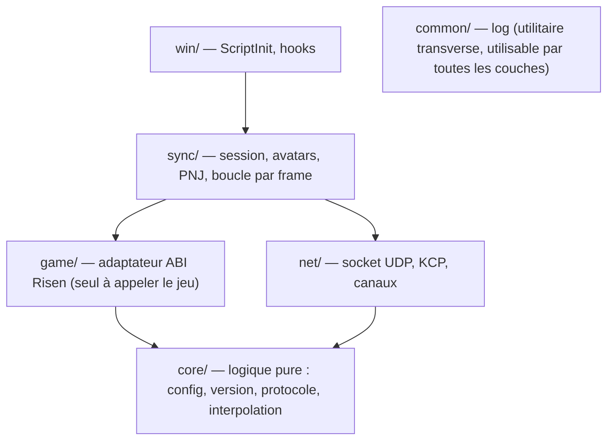
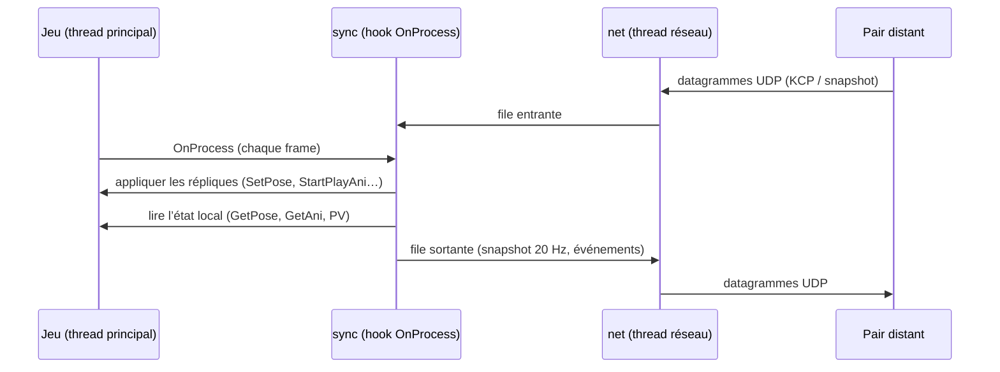
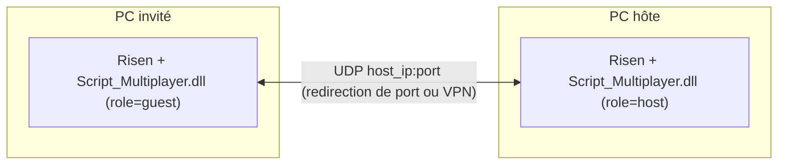

# Architecture Spine — Risen Multiplayer (J1–J2)

## Design Paradigm

**Réplication à autorité hôte.** Le jeu de l’hôte est la seule source de vérité pour le monde, les PNJ et les combats. Il publie des **snapshots** d’état à fréquence fixe sur un canal non fiable, et des **événements** sur un canal fiable. L’invité affiche des répliques interpolées, et il exprime des **intentions** (par exemple « j’ai touché ce PNJ ») au lieu de modifier l’état.

Le code est organisé en quatre couches. Les dépendances ne vont que vers le bas : `sync` utilise `game`, `net` et `core` ; `game` et `net` n’utilisent que `core`.



## Invariants & Rules

### AD-1 — L’hôte héberge, sans serveur séparé [ADOPTED]

- **Binds:** FR-4, FR-5, FR-8
- **Prevents:** un relais tiers, un deuxième langage, un protocole dupliqué en Go et en C++.
- **Rule:** La DLL de l’hôte ouvre le socket UDP et accepte **exactement un** invité. L’invité se connecte directement à `host_ip:port`. Pas de binaire `server/` ni de Go pour le MVP. Une seconde demande de connexion est refusée par un message `Reject`.

### AD-2 — Le jeu n’est touché que depuis le thread principal

- **Binds:** all
- **Prevents:** des courses entre le thread réseau et le moteur, qui n’est pas thread-safe.
- **Rule:** Tout appel à une fonction du jeu se fait **uniquement** depuis le hook de `eCApplication::OnProcess` (une fois par frame). Le thread réseau ne fait qu’envoyer et recevoir. Il échange avec la frame par deux files (entrante et sortante) protégées par un verrou ; aucune autre donnée n’est partagée.

### AD-3 — Un seul adaptateur ABI, résolu en bloc [ADOPTED]

- **Binds:** all
- **Prevents:** des appels au jeu dispersés, avec des signatures fausses ou des erreurs de sret.
- **Rule:** Seul `game/` appelle le jeu. Chaque fonction est résolue par son nom décoré (`GetProcAddress`) à l’initialisation, en **tout ou rien** : un symbole manquant laisse le mod inactif. Les retours d’objets passent par la forme explicite `Ret* (*)(This*, Ret* out, …)`, et les statiques par `Ret* (*)(Ret* out, …)`. Une classe passée **par valeur** (par exemple `Template` ou `bCString`) est une copie construite par l’appelant et **détruite par l’appelé**. Le mod ne détruit donc jamais une copie qu’il a passée. Jamais de pointeur de membre C++. Chaque appel au jeu est protégé par SEH. L’empreinte de version couvre tout module appelé (`Game.dll`, `Engine.dll`, `Script.dll`, `SharedBase.dll`).

### AD-4 — Un socket, un octet de canal

- **Binds:** FR-5, FR-7, FR-9, FR-10
- **Prevents:** des formats de paquets incompatibles entre les deux pairs.
- **Rule:** Un seul socket UDP par pair. Octet 0 d’un datagramme :
  - `0` = KCP, fiable ; son `conv` est l’identifiant de session tiré par l’hôte ;
  - `1` = snapshot, non fiable ;
  - `2` = contrôle, hors KCP : `Hello`, `Welcome`, `Reject`, renvoyés toutes les 500 ms jusqu’à la réponse.

  KCP tourne en mode rapide `ikcp_nodelay(1,10,2,1)` avec `ikcp_setmtu(1199)`, sans FEC ni chiffrement. Un datagramme fait **1200 octets au plus**. Structures binaires little-endian empaquetées, avec un `MsgType` sur `u8`. Le contrat vit dans `protocol/PROTOCOL.md`.

### AD-5 — Poignée de main versionnée

- **Binds:** FR-5, FR-8
- **Prevents:** deux builds différents qui se parlent et désynchronisent en silence.
- **Rule:** L’invité envoie sur le canal de contrôle un `Hello` qui contient `{version du protocole, version du mod, empreinte du jeu, pseudo, équipement}`. L’hôte répond `Welcome{conv, pose de l’avatar hôte}` ou `Reject{raison: u8}`. Le KCP de chaque côté n’est créé qu’après `Welcome`. Le moindre écart donne un `Reject`, et la raison est journalisée des deux côtés. Un heartbeat circule à 1 Hz ; 5 s sans paquet mettent fin à la session.

### AD-6 — Identité réseau NetId

- **Binds:** FR-6, FR-7, FR-9, FR-10, FR-12
- **Prevents:** l’envoi d’adresses mémoire, et des identifiants qui divergent d’un pair à l’autre.
- **Rule:** Toute entité répliquée porte un `NetId` (`u32`) **attribué par l’hôte uniquement**. Valeurs fixes : `1` = avatar de l’hôte, `2` = avatar de l’invité ; les PNJ commencent à `1000`. Chaque pair tient sa propre table `NetId ↔ entité locale`. Aucun pointeur ne circule sur le réseau.

### AD-7 — Snapshots complets à 20 Hz, interpolés

- **Binds:** FR-7, FR-9
- **Prevents:** des schémas de delta incompatibles, et des répliques qui se téléportent.
- **Rule:** Chaque pair envoie à **20 Hz** l’état **complet** des entités dont il a l’autorité : l’hôte envoie son avatar et les PNJ, l’invité envoie son seul avatar. Chaque snapshot contient : `tick`, puis 25 octets par entité : `NetId` u32, position 3×f32, lacet f32, `AniId` u16, compteur de redémarrage d’animation u8, PV u16. Pas de delta. Si un datagramme ne suffit pas, les entités les plus proches d’un joueur passent en premier et les autres au tick suivant. Le récepteur affiche avec **150 ms** de retard, par interpolation (Hermite pour la position, slerp pour la rotation). Il n’attend jamais une retransmission et extrapole au plus 250 ms. `[ASSUMPTION : 20 Hz et 150 ms suffisent]`

### AD-8 — Un seul encodage d’animation, choisi par le spike J1

- **Binds:** FR-7
- **Prevents:** deux encodages d’animation concurrents.
- **Rule :**
  - **Préférence de l’utilisateur : la synchro par nom.** L’émetteur lit le nom de l’animation en cours, et le récepteur la rejoue avec `Entity::StartPlayAni`.
  - Mais `Entity::GetAni` **construit** un nom à partir de paramètres : il ne lit pas l’animation en cours. Le premier spike de J1 doit donc trouver un accesseur de l’animation courante.
  - **Si le spike n’en trouve pas, on passe à la synchro par état**, le repli validé par l’utilisateur : `GetMovementMode`, `GetCurrentAniDirection` et la posture de combat sont envoyés, et le récepteur reconstruit le nom avec `GetAni`.
  - Dans les deux cas, les noms sont **internés** : un événement fiable `AniName{AniId, nom}` part la première fois, puis seul l’`AniId` (u16) circule.
  - Le choix est inscrit ici avant la story « avatar ».

### AD-9 — Les PNJ n’obéissent qu’à l’hôte (J2)

- **Binds:** FR-9, FR-10, FR-11
- **Prevents:** un état de PNJ qui diverge entre les deux jeux.
- **Rule :**
  - L’hôte réplique les PNJ hostiles situés à **50 m** au plus d’un des deux joueurs `[ASSUMPTION]`.
  - Chez l’invité, l’IA de ces PNJ est neutralisée, et leur position, leur animation, leurs PV et leur mort viennent exclusivement des snapshots et des événements.
  - L’invité ne modifie **jamais** l’état d’une réplique. Un coup porté produit un événement fiable `HitRequest{NetId cible, dégâts}` ; l’hôte l’applique avec la fonction de dégâts du jeu.
  - Chez l’hôte, l’avatar de l’invité est **invulnérable**. Quand un PNJ le touche, l’hôte envoie l’événement fiable `HitOnGuest{NetId source, dégâts}`, et l’invité applique ces dégâts **à son propre héros** (FR-11).
  - **PNJ natifs chez l’invité :** ils existent déjà, puisque les deux joueurs chargent la même sauvegarde. Hypothèse retenue : on les apparie aux `NetId` de l’hôte par leur **GUID d’entité**. Le mécanisme d’appariement et de neutralisation de l’IA est fixé par le spike du début de J2. **Il est inscrit dans cette spine avant toute story `sync/npc`.**

### AD-10 — Événements fiables, liste fermée

- **Binds:** FR-5, FR-6, FR-8, FR-9, FR-10, FR-12
- **Prevents:** des messages ad hoc ajoutés sans contrat.
- **Rule:** Le canal de contrôle ne transporte que `Hello`, `Welcome` et `Reject`. Le canal fiable ne transporte que ces types : `Heartbeat`, `AniName`, `Spawn{NetId, type, pose}`, `Despawn{NetId}`, `HitRequest`, `HitOnGuest`, `Death{NetId}`, `Respawn{NetId, pose}`, `SessionEnd{raison: u8}`. Ajouter un type exige de mettre à jour `PROTOCOL.md` et d’incrémenter la version du protocole.

### AD-11 — Session : une machine à états

- **Binds:** FR-4, FR-5, FR-8, FR-12
- **Prevents:** des fins de session traitées différemment selon l’endroit du code.
- **Rule :**
  - Chemin nominal : `Inactive → Hosting | Connecting → InSession → Ended → Inactive`.
  - Si le mod est actif, les hooks sont installés dans `ScriptInit`. `Hosting` et `Connecting` démarrent au premier `OnProcess` où un monde est chargé ; le moyen de le détecter est établi par le spike J1.
  - Tout ce qui termine une session (mort de l’hôte, timeout, quitter, rechargement de sauvegarde, retour au menu, `Reject`) passe par **la même** transition vers `Ended`. Elle supprime les avatars et les répliques, puis rend la main au jeu solo.
  - À la mort de l’invité, l’hôte envoie `Respawn` près de l’avatar de l’hôte, PV pleins (FR-12).

## Consistency Conventions

| Concern | Convention |
| --- | --- |
| Espaces de noms | `mp::core`, `mp::net`, `mp::game`, `mp::sync`, `mp::win`, `mp::log` ; un dossier par couche dans `client/src/`. Migration du code J0 (`win/game_abi` vers `game/`, `win/log` vers `common/`, `mp::abi` vers `mp::game`) dans la **première story de J1** |
| Messages | `enum class MsgType : u8`, une struct empaquetée par message dans `core/protocol.h`, encodage et décodage testés sous Linux |
| Données | Little-endian ; positions en `float` (centimètres du jeu) ; temps en `tick` (`u32`, 20 Hz) ; textes en UTF-8 préfixés par une longueur `u8` |
| Erreurs | Pas d’exception qui franchit une couche. `game/` et `net/` retournent `bool` ou un résultat, et `sync/` décide. Toute erreur d’initialisation laisse le mod **inactif**, sans crash ni boîte de dialogue |
| Log | `mp::log` (J0), avec un préfixe de sous-système (`[net]`, `[game]`, `[sync]`). Rien n’est journalisé à chaque frame, sauf derrière `log_level = debug` dans l’ini (clé ajoutée en J1) |
| Config | Nouvelles clés ajoutées à `multiplayer.ini` (J0). Toute valeur a un défaut documenté dans `multiplayer.example.ini` |
| Tests | `core/` est couvert par des tests unitaires Linux. `net/` est testé en boucle locale sous Linux, puis sous Wine. `game/` et `sync/` sont validés par le banc Wine et le jeu réel |
| Tiers | Sources vendorisées dans `client/third_party/` (MinHook, KCP) et compilées directement dans la cible du client, sans leurs propres CMakeLists. Licence et version notées ; MinHook est figé sur un **commit précis**, avec son hash |

## Stack

| Name | Version |
| --- | --- |
| C++ | 17 |
| clang-cl / lld-link (LLVM) | 23.1.3 |
| xwin (CRT + SDK Windows) | 0.10.0 |
| CMake | ≥ 3.21 (4.3.0 en local) |
| MinHook | 1.3.4 + correctifs de `master`, figé sur un commit noté dans `third_party/` |
| KCP (skywind3000, `ikcp.c`) | 2.1.1 |
| Cible | Risen Steam x64 (empreinte de janvier 2023), Windows et Proton |

## Structural Seed

```text
client/
  src/core/      # config, version (J0), protocol (codec), interpolation, netid — pur, testé sous Linux
  src/net/       # socket UDP non bloquant, KCP, démultiplexage des canaux, thread réseau
  src/game/      # adaptateur ABI : Entity (Spawn, GetPlayer, Get/SetPose, MoveTo, StartPlayAni, GetAni, Kill), dégâts, IA
  src/sync/      # session (AD-11), avatars (J1), réplication des PNJ (J2), tick par frame
  src/win/       # ScriptInit (J0), installation des hooks MinHook
  src/common/    # log (J0), utilitaire transverse
  third_party/   # minhook/, kcp/
  tests/         # unitaires (Linux) + wine/ (banc d’intégration)
protocol/
  PROTOCOL.md    # contrat binaire (AD-4, AD-5, AD-10)
```





## Capability → Architecture Map

| Capability / Area | Lives in | Governed by |
| --- | --- | --- |
| FR-4 Héberger, FR-5 Rejoindre | `sync/session`, `net/` | AD-1, AD-4, AD-5, AD-11 |
| FR-6 Apparition de l’invité | `sync/avatar`, `game/entity` | AD-3, AD-6, AD-10 |
| FR-7 Avatar synchronisé | `sync/avatar`, `core/interpolation` | AD-2, AD-7, AD-8 |
| FR-8 Fin de session | `sync/session` | AD-5, AD-11 |
| FR-9 Répliques de PNJ | `sync/npc`, `game/ai` | AD-6, AD-7, AD-9 |
| FR-10, FR-11 Dégâts | `sync/npc`, `game/combat` | AD-9, AD-10 |
| FR-12 Mort et réapparition | `sync/session`, `game/entity` | AD-10, AD-11 |

## Operational Envelope

- **Livraison :** une DLL et un fichier `multiplayer.ini`, copiés dans `<Risen>/bin/scripts/` (voir le README). Pas d’installeur.
- **Environnements :** Windows et Linux/Proton, sur le build Steam x64 de janvier 2023 uniquement. Le chargeur natif fonctionne sans `WINEDLLOVERRIDES` (validé en J0).
- **Cohérence :** les deux joueurs doivent avoir le même build du mod. AD-5 rejette toute différence.
- **Réseau :** UDP, port 27960 par défaut. L’hôte ouvre ce port (redirection sur sa box) ou passe par un VPN de jeu.
- **Diagnostic :** `Script_Multiplayer.log` à côté de la DLL. Chaque transition de session (AD-11) et chaque `Reject` y sont journalisés.

## Open Questions

1. Accesseur de l’animation courante (AD-8) : spike au début de J1.
2. Template de l’avatar pour `Entity::Spawn`, et détection du « monde chargé » (AD-11) : spike au début de J1.
3. Appariement des PNJ natifs de l’invité et neutralisation de leur IA, fonction de dégâts côté hôte, invulnérabilité de l’avatar invité (AD-9) : spike au début de J2.
4. Vérifier en jeu que `eCApplication::OnProcess` est appelé une fois par frame, sur le thread principal (AD-2) : premier test de J1.

## Deferred

- **J3 à J5** (dialogues, persistance du profil invité, relèvement d’un joueur à terre) : hors périmètre de cette spine. Le profil invité de J4 sera un fichier écrit par la DLL de l’hôte (AD-1).
- **Traversée de NAT, chiffrement, compression delta, plus de 2 joueurs** : non-objectifs du MVP.
- **Équipement de l’invité** (`guest_equipment`) : il voyage dans `Hello` (AD-5) ; son format et son application sont choisis dans la story FR-6.
- **CI** : les builds et les tests restent locaux. Une CI GitHub viendra si le projet est repris.
