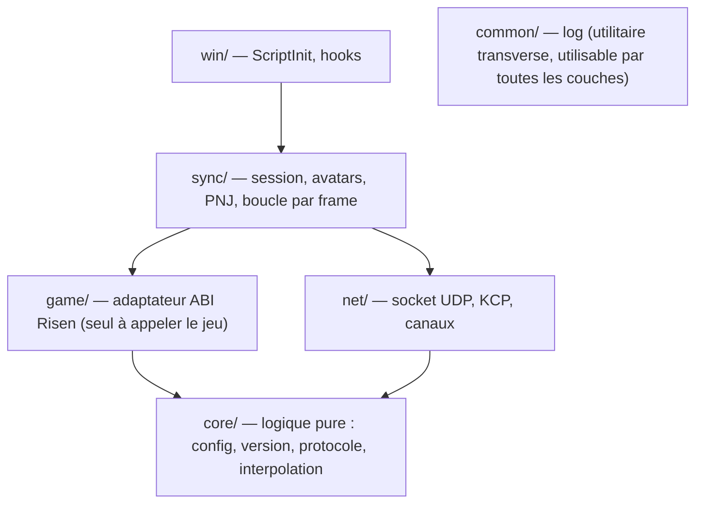
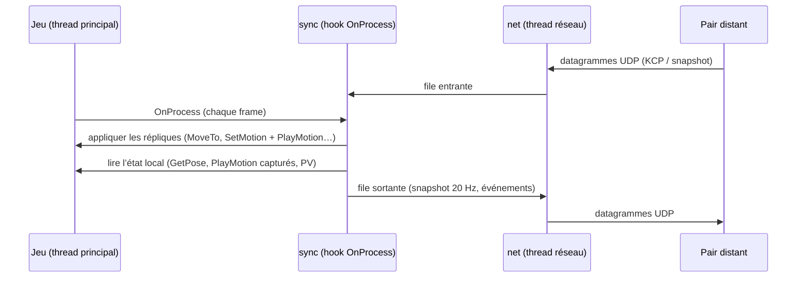
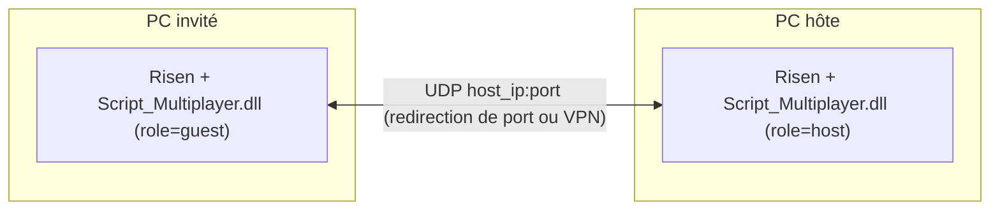

# Architecture Spine — Risen Multiplayer (J1–J2)

## Design Paradigm

**Réplication à autorité hôte.** Le jeu de l’hôte est la seule source de vérité pour le monde, les PNJ et les combats. Il publie des **snapshots** d’état à fréquence fixe sur un canal non fiable, et des **événements** sur un canal fiable. L’invité affiche des répliques interpolées, et il exprime des **intentions** (par exemple « j’ai touché ce PNJ ») au lieu de modifier l’état.

Le code est organisé en quatre couches. Les dépendances ne vont que vers le bas : `sync` utilise `game`, `net` et `core` ; `game` et `net` n’utilisent que `core`.



## Invariants & Rules

### AD-1 — L’hôte héberge, sans serveur séparé [ADOPTED]

- **Binds:** FR-4, FR-5, FR-8
- **Prevents:** un relais tiers, un deuxième langage dans le produit, un protocole qui diverge entre le mod et l’outil de test.
- **Rule:** La DLL de l’hôte ouvre le socket UDP et accepte **exactement un** invité. L’invité se connecte directement à `host_ip:port`. Pas de binaire `server/` ni de Go pour le MVP. Une seconde demande de connexion est refusée par un message `Reject`. Seule exception : l’outil de test `tools/fake-guest/` (Go, jamais livré), qui joue un invité scripté ; il ne doit pas diverger du contrat : les vecteurs binaires de `protocol/vectors/` sont vérifiés par les tests C++ et Go, et son KCP est le même `ikcp.c` compilé via cgo.

### AD-2 — Le jeu n’est touché que depuis le thread principal

- **Binds:** all
- **Prevents:** des courses entre le thread réseau et le moteur, qui n’est pas thread-safe.
- **Rule:**
  - Tout appel à une fonction du jeu se fait **uniquement** depuis le hook de `eCApplication::OnProcess`. Exceptions :
    - le hook `PlayMotion` (AD-8), qui ne fait que copier des octets ou bloquer l’appel ;
    - le hook de `gCScriptRoutine_PS::OnProcess` (AD-9), qui ne fait que comparer le PS reçu à l’ensemble des répliques ;
    - les détours de fonctions de script de `Script_Game.dll` (`DownOrDeadBy*`, AD-11). Ils tournent sur le thread d’`OnProcess` (vérifié en jeu) et peuvent appeler le jeu de façon synchrone : `SetHitPoints`, ou les accesseurs de l’unité de script (`GetOtherEntity`).
  - Le thread réseau ne fait qu’envoyer et recevoir. Il échange avec la frame par deux files (entrante et sortante) protégées par un verrou ; aucune autre donnée n’est partagée.
  - **Hooks ↔ frame.** Leur seul état partagé est un objet unique, `sync::AnimFilter`, protégé par un verrou ; en J2 il devient le registre d’AD-12. Il contient :
    - le PS d’animation du héros local, dont les appels sont capturés ;
    - l’ensemble des PS des répliques, sur lesquels l’appel du moteur est bloqué ;
    - l’anneau des captures.

    Règles d’usage :
    - Le rejeu (`SetMotion` + `PlayMotion` + `MoveTo`) se fait sous un garde de rejeu `thread_local`, que le hook laisse passer.
    - Le hook ne bloque **jamais** un appel sur le PS du héros local.
    - Une entité est retirée du filtre **avant** d’être oubliée ou détruite.

    `[ASSUMPTION : le hook est appelé sur le thread principal ; la première story le journalise]`
  - `OnProcess` est appelé une fois par itération de la boucle principale, toujours sur le même thread (vérifié en jeu). Il n’est pas bridé : 160 à 250 appels/s en partie, plus de 2 000 au menu. Toute cadence et tout délai (snapshots 20 Hz, heartbeat, timeouts, interpolation) se mesurent donc **à l’horloge** (`QueryPerformanceCounter`), jamais en nombre d’appels.

### AD-3 — Un seul adaptateur ABI, résolu en bloc [ADOPTED]

- **Binds:** all
- **Prevents:** des appels au jeu dispersés, avec des signatures fausses ou des erreurs de sret.
- **Rule:** Seul `game/` appelle le jeu. Chaque fonction est résolue par son nom décoré (`GetProcAddress`) à l’initialisation, en **tout ou rien** : un symbole manquant laisse le mod inactif. Les retours d’objets passent par la forme explicite `Ret* (*)(This*, Ret* out, …)`, et les statiques par `Ret* (*)(Ret* out, …)`. Une classe passée **par valeur** (par exemple `Template` ou `bCString`) est une copie construite par l’appelant et **détruite par l’appelé**. Le mod ne détruit donc jamais une copie qu’il a passée. À l’inverse, un objet **retourné** par valeur (sret, par exemple le `bCString` de `GetFileTitleA`) appartient au mod, qui le détruit. Les offsets codés en dur (emplacements de motion, AD-8) sont documentés dans `docs/re/` et couverts par l’empreinte de version. Jamais de pointeur de membre C++. Chaque appel au jeu est protégé par SEH. L’empreinte de version couvre tout module appelé (`Game.dll`, `Engine.dll`, `Script.dll`, `SharedBase.dll`, `Script_Game.dll`). `Script_Game.dll` est chargée par le jeu avant le mod `[ASSUMPTION : ordre de chargement, confirmé par chaque test en jeu]` ; le mod ne la charge jamais lui-même, et le banc Wine la charge avant le mod.

### AD-4 — Un socket, un octet de canal

- **Binds:** FR-5, FR-7, FR-9, FR-10
- **Prevents:** des formats de paquets incompatibles entre les deux pairs.
- **Rule:** Un seul socket UDP par pair. Octet 0 d’un datagramme :
  - `0` = KCP, fiable ; son `conv` est l’identifiant de session tiré par l’hôte ;
  - `1` = snapshot, non fiable ;
  - `2` = contrôle, hors KCP : `Hello`, `Welcome`, `Reject`, renvoyés toutes les 500 ms jusqu’à la réponse.

  KCP tourne en mode rapide `ikcp_nodelay(1,10,2,1)` avec `ikcp_setmtu(1199)`, sans FEC ni chiffrement. Un datagramme fait **1200 octets au plus**. Structures binaires little-endian empaquetées, avec un `MsgType` sur `u8`. Le contrat vit dans `protocol/PROTOCOL.md`.

### AD-5 — Poignée de main versionnée

- **Binds:** FR-5, FR-8
- **Prevents:** deux builds différents qui se parlent et désynchronisent en silence.
- **Rule:** L’invité envoie sur le canal de contrôle un `Hello` qui contient `{version du protocole, version du mod, empreinte du jeu, pseudo, équipement}`. L’hôte répond `Welcome{conv, pose de l’avatar hôte}` ou `Reject{raison: u8}`. Le KCP de chaque côté n’est créé qu’après `Welcome`. Un `Hello` venant de la **même** adresse `ip:port` (retransmission) reçoit le **même** `Welcome`, avec le même `conv`. L’hôte cesse de renvoyer `Welcome` dès le premier segment KCP portant ce `conv`. Seule une autre adresse reçoit `Reject` (AD-1). Le moindre écart donne un `Reject`, et la raison est journalisée des deux côtés. Un heartbeat circule à 1 Hz ; 5 s sans paquet mettent fin à la session.

### AD-6 — Identité réseau NetId

- **Binds:** FR-6, FR-7, FR-9, FR-10, FR-12
- **Prevents:** l’envoi d’adresses mémoire, et des identifiants qui divergent d’un pair à l’autre.
- **Rule:** Toute entité répliquée porte un `NetId` (`u32`) **attribué par l’hôte uniquement**. Valeurs fixes : `1` = avatar de l’hôte, `2` = avatar de l’invité ; les PNJ commencent à `1000`. Chaque pair tient sa propre table `NetId ↔ entité locale`. Aucun pointeur ne circule sur le réseau.

### AD-7 — Snapshots complets à 20 Hz, interpolés

- **Binds:** FR-7, FR-9
- **Prevents:** des schémas de delta incompatibles, et des répliques qui se téléportent.
- **Rule:** Chaque pair envoie à **20 Hz** l’état **complet** des entités dont il a l’autorité : l’hôte envoie son avatar et les PNJ, l’invité envoie son seul avatar. Datagramme de snapshot (canal 1) : `u8 canal`, `u32 tick`, `u8 nombre`, puis 22 octets par entité : `NetId` u32, position 3×f32, lacet f32 (radians, `atan2(m[8], m[10])`), PV u16. Pas de delta. La vitesse utilisée par Hermite se dérive des snapshots successifs.
  - **Temps.** `tick = floor((QPC − t0) / 50 ms)` chez l’émetteur, où `t0` est son entrée en `InSession`. `Motion` est daté en millisecondes (u32) dans la même base. Chaque pair tient **une seule** horloge distante par pair, dans `core/`.
  -  L’animation **n’est pas** dans le snapshot : c’est un flux d’événements `Motion` (AD-8). Si un datagramme ne suffit pas, les entités les plus proches d’un joueur passent en premier et les autres au tick suivant. Le récepteur affiche avec **150 ms** de retard, par interpolation (Hermite pour la position, slerp pour la rotation). Il n’attend jamais une retransmission et extrapole au plus 250 ms. `[ASSUMPTION : 20 Hz et 150 ms suffisent]`

### AD-8 — Animation : rejeu des `PlayMotion` par nom [ADOPTED]

- **Binds:** FR-6, FR-7, FR-9
- **Prevents:** deux encodages d’animation concurrents ; une réplique (avatar ou PNJ) animée à la fois par le moteur et par la réplication.
- **Rule :**
  - **Portée.** Ce rejeu vaut pour toute entité répliquée : le pair qui en a l’autorité émet ses `Motion`, l’autre la rejoue. En J1, c’est le héros de chacun. En J2, l’hôte émet aussi pour les PNJ ; leur budget de `Motion` est fixé avant toute story `sync/npc`.
  - **Émetteur.** Le hook de `eCAnimation_PS::PlayMotion` (Engine.dll) ne retient que les appels sur un PS capturé (`AnimFilter`, AD-2), et n’y copie que des octets.
    - Le nom vient de la ressource rangée dans l’emplacement du type : `this + 0x120 + type*0x10`, puis `eCResource2::GetFileTitleA()`, résolu depuis la frame.
    - Les noms sont **internés** : un événement fiable `AniName{AniId, nom}` part la première fois, puis seul l’`AniId` (u16) circule. Chaque émetteur a son propre espace d’`AniId`, remis à zéro à `Ended`. `AniName` précède toujours son premier `Motion` sur le même canal fiable. Un `AniId` inconnu fait ignorer le `Motion`, avec une ligne de log.
    - Chaque appel donne un événement fiable `Motion{NetId, tick, type u8, AniId u16, flag u8, paramètres}`.
  - **Récepteur.** Il applique `Motion` au même retard d’interpolation que les snapshots (AD-7). Un `Motion` en retard s’applique tout de suite. Pour les types 0 et 1 (locomotion), seul le plus récent par type et par frame est appliqué. La disposition exacte de `Motion` est fixée dans `PROTOCOL.md`. Ordre d’application :
    1. `eCResource2::GetMotion(nom)` donne la ressource ;
    2. `eCAnimation_PS::SetMotion(type, ressource)` la range dans l’emplacement ;
    3. `PlayMotion(type, descripteur reconstruit, flag)` la lance.
  - **Le descripteur `eSMotionPlayBackDesc` (0x60 octets) n’est jamais transmis brut**, car il contient des pointeurs. `Motion` ne porte que des champs scalaires identifiés. `[ASSUMPTION : temps de fondu f32 à +0x00, poids à +0x0C/+0x14 ; à établir dans la story avatar]`
  - **Seule la réplication anime une réplique.** Le hook bloque (n’appelle pas l’original) tout `PlayMotion` que le moteur lance de lui-même sur le PS d’une réplique.
  - **Avatar.**
    - Il est créé **uniquement** à réception de `Spawn{NetId}`, par `Entity::Spawn(template du héros local, pose, temporary = true)` ; la copie ne prend pas le contrôle du joueur (vérifié).
    - `sync/avatar` est le **seul** propriétaire de sa pose et de son animation.
    - `Spawn` et `Respawn` réinitialisent l’interpolation.
    - La sonde (`probe = 1`) et la session sont exclusives : un seul détour `PlayMotion` est actif.
  - **Placement.** En J1, `Entity::MoveTo(bCMatrix)` place l’avatar à chaque frame ; `SetPose` seul laisse le contrôleur de personnage et l’équipement en place. En J2, l’avatar devient **solide**. Recette complète (mode 2 de la sonde) :
    - `SetCollisionGroup(4)`, `EnableCollision(true)` et `PSNavigation::SetDCCEnabled(true)` ;
    - `PSRigidBody::AddBodyFlag(0x81)` (sens du drapeau `[ASSUMPTION : cinématique + sans gravité]`) et `PSCharacterMovement::EnableGravitation(false)` ;
    - placement à chaque frame par `Entity::SetPose` puis `PSRigidBody::SetPose`, sans `StopMovement`.

    Le héros local ne traverse plus l’avatar (observé par l’utilisateur au 2ᵉ test). `SetGoalPose` est écarté : l’avatar glisse. `[ASSUMPTION : l’équipement suit en mode cinématique ; c’est la première tâche de la story concernée]`
  - **Repères.** `bCMatrix` est en lignes : translation en `m[12..14]`, Y vertical, axe avant en ligne 2, unités en centimètres (vérifié).
  - **Validé** par les stories 2.1 à 2.4b : rejeu par nom (`GetMotion`), descripteur reconstruit, et réglages de locomotion transmis par `MotionParam`.

### AD-9 — Les PNJ n’obéissent qu’à l’hôte (J2)

- **Binds:** FR-9, FR-10, FR-11
- **Prevents:** un état de PNJ qui diverge entre les deux jeux ; un coup compté deux fois (natif + événement).
- **Rule :**
  - L’hôte réplique les PNJ hostiles situés à **50 m** au plus d’un des deux joueurs `[ASSUMPTION]`.
  - **Répliques chez l’invité = ses PNJ natifs**, appariés à l’hôte (même sauvegarde) :
    - **Clé.** Le GUID de 16 octets : octets 0 à 15 du `bCPropertyID` de `eCDynamicEntity::GetID` ; les octets 16 à 19 sont un cache, toujours nuls dans les tests. L’invité reconstruit l’identifiant (GUID + 4 octets nuls) et le retrouve par `gCRuntimeInfo::GetEntity`. Stable d’un rechargement à l’autre (vérifié) ; identique d’un PC à l’autre `[ASSUMPTION : à vérifier dans la story 3.3]`. Un `NetId` reste lié à son GUID pendant toute la session.
    - **IA.** Neutralisée PNJ par PNJ par le hook de `gCScriptRoutine_PS::OnProcess`, qui n’appelle pas l’original pour une réplique (registre d’AD-12). `EnableClassProcessing` est **interdit** (booléen global : il fige tous les PNJ).
    - **État.** Position, animation, PV et mort ne viennent que des snapshots et des événements de l’hôte. `sync/npc` est le seul à les écrire chez l’invité ; il peut fixer leurs PV directement (affichage de la jauge).
    - **À `Ended`**, une réplique est **libérée** (sortie du registre, IA rendue), jamais détruite : c’est une entité native de l’invité.
  - **Coups (une seule source par pair).** Un coup natif est bloqué au **point d’accroche des dégâts** (question 8, unique, possédé par AD-12) dès qu’une des deux entités n’est pas sous l’autorité locale, puis converti en événement :
    - **Invité, son héros frappe une réplique** → bloqué, émet `HitRequest{NetId cible}`.
    - **Invité, une réplique frappe son héros** → bloqué ; les dégâts n’arrivent que par `HitOnGuest`.
    - **Hôte, l’avatar invité frappe un PNJ** → bloqué ; les dégâts n’arrivent que par `HitRequest`.
    - **Hôte, un PNJ frappe l’avatar invité** → bloqué (l’avatar est **invulnérable**), émet `HitOnGuest{NetId source, dégâts bruts}` (avant la protection de l’invité).
  - **Application chez l’hôte.** `HitRequest` s’applique par `PSDamage::DoDamage(arme en main de l’avatar invité, cible, agresseur = avatar invité)` : les dégâts sont ceux de l’arme. Chez l’hôte, ne jamais écrire directement les PV d’un PNJ.
  - **Application chez l’invité.** `HitOnGuest` passe par le seul chemin de PV du héros invité (AD-11).
  - **PV de l’avatar invité chez l’hôte** : affichage seulement (recopiés du snapshot), jamais utilisés pour détecter un coup.
  - **Arme de l’avatar.** Créée dans son inventaire (`PSInventory::CreateItems(template)`), tenue par `HoldRightStack`, rangée par `EquipStack`. Il n’y a pas de mode de combat à transmettre : la posture est dans le nom des animations rejouées (AD-8).

### AD-10 — Événements fiables, liste fermée

- **Binds:** FR-5, FR-6, FR-8, FR-9, FR-10, FR-12
- **Prevents:** des messages ad hoc ajoutés sans contrat.
- **Rule:**
  - Le canal de contrôle ne transporte que `Hello`, `Welcome` et `Reject`.
  - Le canal fiable ne transporte que : `Heartbeat`, `SessionEnd{raison: u8}`, `AniName`, `Motion`, `MotionParam` (AD-8), `Spawn`, `Despawn{NetId}`, `Death{NetId}`, `HitRequest{NetId cible}`, `HitOnGuest{NetId source, dégâts bruts}`, `Respawn{NetId, pose}`.
  - **`Spawn` dépend de son `type`** : `0` = avatar `{NetId, type, pose}` ; `1` = PNJ `{NetId, type, pose, GUID 16 o}` (story 3.3).
  - Ajouter un type **ou changer une struct** (y compris le tableau d’empreinte de `Hello`) exige de mettre à jour `PROTOCOL.md` et les vecteurs `protocol/vectors/`, et d’incrémenter la version du protocole.

### AD-11 — Session : une machine à états

- **Binds:** FR-4, FR-5, FR-8, FR-12
- **Prevents:** des fins de session traitées différemment selon l’endroit du code ; plusieurs chemins qui écrivent les PV ou déclarent la mort de l’invité.
- **Rule :**
  - Chemin nominal : `Inactive → Hosting | Connecting → InSession → Ended → Inactive`.
  - Si le mod est actif, les hooks sont installés dans `ScriptInit`.
  - **Monde chargé** = `Entity::GetPlayer()` non nul **et** `gCSession::IsGameRunning`. **Fin de monde** = le monde n’est plus chargé, ou le pointeur du héros a changé depuis l’armement (`docs/re/fin-de-monde.md`). Une fin de monde vaut fin de session.
  - Aucun pointeur d’entité n’est gardé hors de la table `NetId` (AD-6), ni réutilisé au-delà de `Ended`.
  - Tout ce qui termine une session (mort de l’hôte, timeout, quitter, fin de monde, `Reject`) passe par **la même** transition vers `Ended`. Elle retire les avatars, **libère** les répliques (AD-9), puis rend la main au jeu solo.
  - **La mort du héros de l’hôte reste native** et finit la session.
  - **Le héros de l’invité ne meurt jamais nativement (FR-12).** Ses PV n’ont qu’**un** chemin d’écriture, dans `sync/` :
    - `HitOnGuest` retire ses dégâts ; un résultat ≤ 0 met le héros **à terre**.
    - Un coup natif restant (source non répliquée) est intercepté dans les détours `DownOrDeadByMeleeWeapon`, `DownOrDeadByProjectile` et `DownOrDeadByInferno` (`self` = ce qui frappe, `other` = la victime). Si la victime est le héros invité **et** que ses PV sont ≤ 0, le détour le remet à 1 PV, le met à terre et rend 0 sans appeler l’original. Sinon il appelle l’original.
    - **À terre** : 1 PV, `Death{2}` émis **une seule fois** (verrou jusqu’au `Respawn`). L’hôte répond `Respawn{2, pose}` près de son avatar ; l’invité y place son héros, PV pleins, et réinitialise l’interpolation.
  - Écartés au spike : `Kill → Defeat` (mène au menu de chargement), état `ZS_Unconscious` forcé, relève d’un mort.

### AD-12 — Hooks de combat et registre des entités (J2)

- **Binds:** FR-9, FR-10, FR-11, FR-12
- **Prevents:** deux stories qui posent le même hook (le second `MH_CreateHook` échoue) ; deux filtres de répliques qui divergent.
- **Rule :**
  - **Liste fermée des hooks**, tous installés par `win/hooks` et nulle part ailleurs :
    - `eCApplication::OnProcess` ;
    - `eCAnimation_PS::PlayMotion` et `SetRagDollEnabled` ;
    - les quatre réglages de locomotion EMotionFX (story 2.4b) ;
    - `gCScriptRoutine_PS::OnProcess` ;
    - les trois `DownOrDeadBy*` ;
    - le point d’accroche des dégâts (question 8).

    Un seul détour par fonction. Il délègue à `sync/` et choisit son comportement selon le **rôle** de l’entité. Ajouter un hook exige de mettre à jour cette liste.
  - **Registre unique** (extension de `sync::AnimFilter`, AD-2, même verrou) : pour chaque entité suivie, `{entité, PS d’animation, PS de routine, rôle}`. Rôles : héros local, avatar, réplique de PNJ.
    - Il est alimenté **uniquement** par le module propriétaire : `sync/avatar` pour les avatars, `sync/npc` pour les répliques.
    - Une entité en sort avant d’être oubliée ou libérée.
    - Les détours ne font que lire le registre.
  - La sonde (`probe = 1`) et la session sont exclusives pour **tous** ces détours.

## Consistency Conventions

| Concern | Convention |
| --- | --- |
| Espaces de noms | `mp::core`, `mp::net`, `mp::game`, `mp::sync`, `mp::win`, `mp::log` ; un dossier par couche dans `client/src/`. Migration du code J0 vers ces couches : faite (spec de la sonde J1) |
| Messages | `enum class MsgType : u8`, une struct empaquetée par message dans `core/protocol.h`, encodage et décodage testés sous Linux |
| Données | Little-endian ; positions en `float` (centimètres du jeu) ; temps en `tick` (`u32`, 20 Hz) ; textes en UTF-8 préfixés par une longueur `u8` |
| Erreurs | Pas d’exception qui franchit une couche. `game/` et `net/` retournent `bool` ou un résultat, et `sync/` décide. Toute erreur d’initialisation laisse le mod **inactif**, sans crash ni boîte de dialogue |
| Log | `mp::log` (J0), avec un préfixe de sous-système (`[net]`, `[game]`, `[sync]`). Rien n’est journalisé à chaque frame, sauf derrière `log_level = debug` dans l’ini (clé ajoutée en J1) |
| Config | Nouvelles clés ajoutées à `multiplayer.ini` (J0). Toute valeur a un défaut documenté dans `multiplayer.example.ini` |
| Tests | `core/` est couvert par des tests unitaires Linux. `net/` est testé en boucle locale sous Linux, puis sous Wine. `game/` et `sync/` sont validés par le banc Wine et le jeu réel |
| Tiers | Sources vendorisées dans `client/third_party/` (MinHook, KCP) et compilées directement dans la cible du client, sans leurs propres CMakeLists. Licence et version notées ; MinHook est figé sur un **commit précis**, avec son hash |

## Stack

| Name | Version |
| --- | --- |
| C++ | 17 |
| clang-cl / lld-link (LLVM) | 23.1.3 |
| xwin (CRT + SDK Windows) | 0.10.0 |
| CMake | ≥ 3.21 (4.3.0 en local) |
| MinHook | 1.3.4 + correctifs de `master`, figé sur un commit noté dans `third_party/` |
| KCP (skywind3000, `ikcp.c`) | 2.1.1 |
| Cible | Risen Steam x64 (empreinte de janvier 2023), Windows et Proton |

## Structural Seed

```text
client/
  src/core/      # config, version (J0), protocol (codec), interpolation, netid — pur, testé sous Linux
  src/net/       # socket UDP non bloquant, KCP, démultiplexage des canaux, thread réseau
  src/game/      # adaptateur ABI : Entity (Spawn, GetPlayer, GetPose, MoveTo, Kill), animation (PlayMotion, SetMotion, noms de ressources), dégâts, IA
  src/sync/      # session (AD-11), avatars (J1), réplication des PNJ (J2), tick par frame
  src/win/       # ScriptInit (J0), installation des hooks MinHook
  src/common/    # log (J0), utilitaire transverse
  third_party/   # minhook/, kcp/
  tests/         # unitaires (Linux) + wine/ (banc d’intégration)
protocol/
  PROTOCOL.md    # contrat binaire (AD-4, AD-5, AD-10)
```





## Capability → Architecture Map

| Capability / Area | Lives in | Governed by |
| --- | --- | --- |
| FR-4 Héberger, FR-5 Rejoindre | `sync/session`, `net/` | AD-1, AD-4, AD-5, AD-11 |
| FR-6 Apparition de l’invité | `sync/avatar`, `game/entity` | AD-3, AD-6, AD-10 |
| FR-7 Avatar synchronisé | `sync/avatar`, `core/interpolation` | AD-2, AD-7, AD-8 |
| FR-8 Fin de session | `sync/session` | AD-5, AD-11 |
| FR-9 Répliques de PNJ | `sync/npc`, `game/ai` | AD-6, AD-7, AD-9, AD-12 |
| FR-10, FR-11 Dégâts | `sync/npc`, `game/combat`, `win/hooks` | AD-9, AD-10, AD-12 |
| FR-12 Mort et réapparition | `sync/session`, `game/combat`, `win/hooks` | AD-2, AD-10, AD-11, AD-12 |

## Operational Envelope

- **Livraison :** une DLL et un fichier `multiplayer.ini`, copiés dans `<Risen>/bin/scripts/` (voir le README). Pas d’installeur.
- **Environnements :** Windows et Linux/Proton, sur le build Steam x64 de janvier 2023 uniquement. Le chargeur natif fonctionne sans `WINEDLLOVERRIDES` (validé en J0).
- **Cohérence :** les deux joueurs doivent avoir le même build du mod. AD-5 rejette toute différence.
- **Réseau :** UDP, port 27960 par défaut. L’hôte ouvre ce port (redirection sur sa box) ou passe par un VPN de jeu.
- **Diagnostic :** `Script_Multiplayer.log` à côté de la DLL. Chaque transition de session (AD-11) et chaque `Reject` y sont journalisés.

## Open Questions

1. ~~Accesseur de l’animation courante (AD-8)~~ : **résolu** par le spike J1 (rejeu des `PlayMotion` par nom).
2. ~~Template de l’avatar et détection du « monde chargé » (AD-11)~~ : **résolu** (template du héros local ; `GetPlayer` non nul).
3. ~~Appariement des PNJ natifs, neutralisation de leur IA, fonction de dégâts (AD-9)~~ : **résolu** par le spike J2 (GUID, hook de routine, `DoDamage`). Le budget de `Motion` pour les PNJ (AD-8) reste à fixer avant toute story `sync/npc`.
4. ~~`OnProcess` une fois par frame sur le thread principal (AD-2)~~ : **confirmé** en jeu, non bridé (cadences à l’horloge).
5. ~~Arme dégainée et mode de combat de l’avatar~~ : **résolu** (inventaire + `HoldRightStack`, pas de mode de combat, AD-9).
6. ~~Collisions entre PNJ et avatar~~ : **résolu** (corps cinématique, AD-8). Les PNJ frappent déjà l’avatar (vérifié).
7. ~~Mort native de l’invité~~ : **résolu** (coup mortel intercepté dans `DownOrDeadBy*`, AD-11).
8. **Point d’accroche des dégâts** (AD-9, AD-12) : il doit voir chaque coup avec son agresseur et sa cible, et pouvoir le bloquer. Candidats : `gCDamage_PS::DoDamage` (une arme frappe) ou le virtuel `OnDamage` de la cible. À trancher dans la **story 3.4**, avant 3.5.
9. **Morts hors `DownOrDeadBy*`** (chute, noyade) et message de perte d’XP (vu seulement avec `Kill → Defeat`) : story 3.6. Seule la mêlée a été testée en jeu ; `Projectile` et `Inferno` ne sont vérifiés qu’au désassemblage.
10. **PNJ créés en cours de partie** (réapparition de monstres) : leur GUID est-il le même chez les deux pairs ? Sinon, repli à fixer dans la spine avant la **story 3.3**.
11. **Mort d’une réplique chez l’invité** : comment `Death` la tue (sans `Kill` natif ?) et ce qu’il advient du butin et de l’XP de l’invité. **Story 3.3**.
12. **Budget de `Motion` et `MotionParam` pour les PNJ** (AD-8) : à fixer avant la **story 3.3**.
13. **Après `Respawn`**, les snapshots de l’invité encore en route peuvent replacer son avatar sur le lieu de la mort chez l’hôte. Remède à fixer dans la **story 3.6** (époque de vie dans le snapshot, ou accusé de `Respawn`).
14. **Équipement de l’invité** (`guest_equipment`) : format de la liste (noms de templates) et façon de transmettre l’arme sortie ou rangée. **Story 3.1**, avant 3.2.

## Deferred

- **J3 à J5** (dialogues, persistance du profil invité, relèvement d’un joueur à terre) : hors périmètre de cette spine. Le profil invité de J4 sera un fichier écrit par la DLL de l’hôte (AD-1).
- **Traversée de NAT, chiffrement, compression delta, plus de 2 joueurs** : non-objectifs du MVP.
- **CI** : les builds et les tests restent locaux. Une CI GitHub viendra si le projet est repris.
